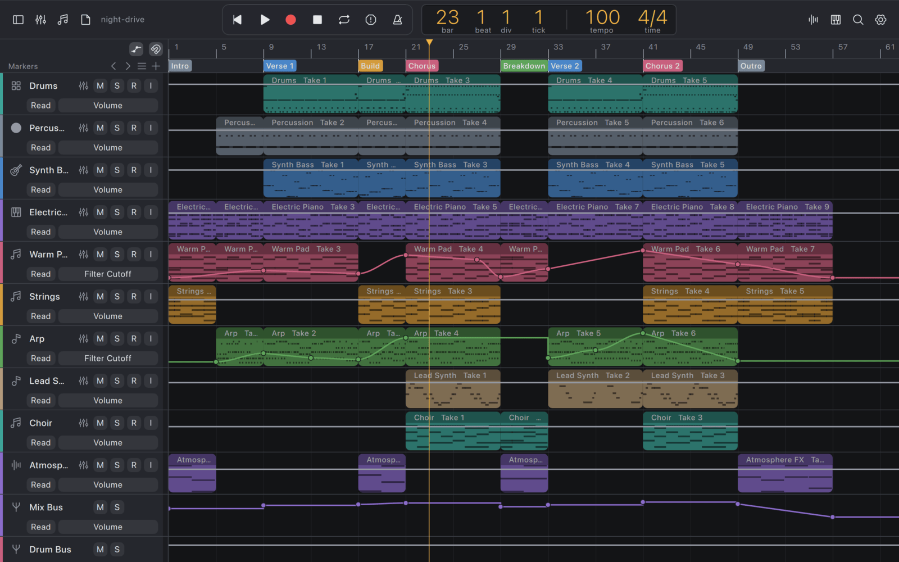
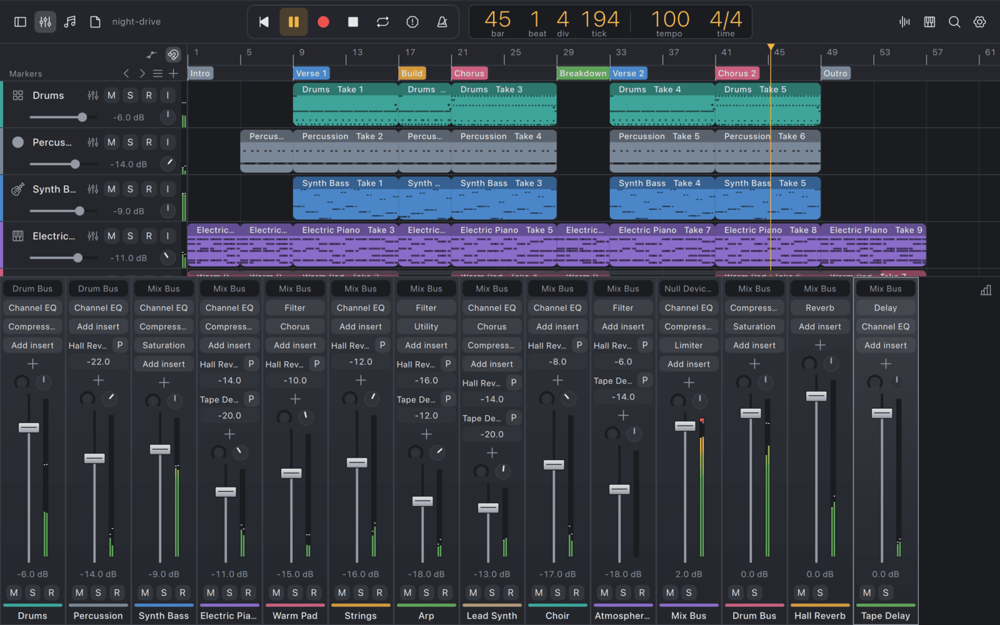
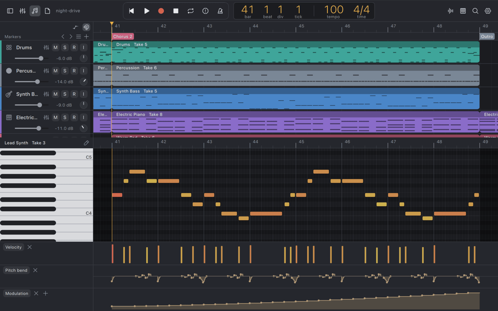
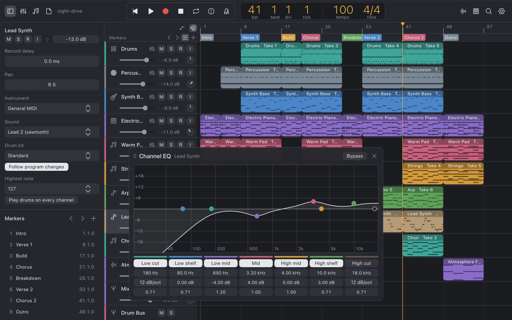
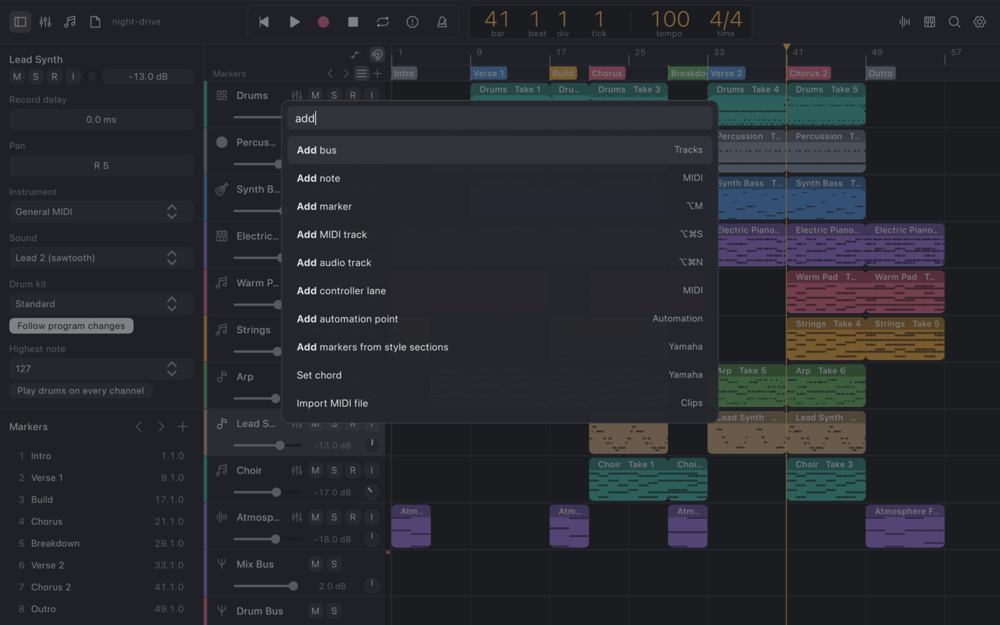

# Emerick

Emerick is a digital audio workstation for recording and producing music that people and AI agents drive through the same actions: the window, a command palette, Lua scripts and MCP.



| | |
|---|---|
|  |  |
|  |  |

## Install

Download the app for macOS (Apple Silicon or Intel), Linux (x86_64 or arm64 AppImage) or Windows (x86_64 zip) from the [latest release](https://github.com/h4ks-com/emerick/releases/latest).

The macOS app has an ad-hoc signature, so clear the download quarantine before the first launch:

```
xattr -dr com.apple.quarantine /Applications/emerick.app
```

To build from source on macOS, run `brew install qt cmake ninja ccache libsndfile fluid-synth lua pkgconf`, then `make run-release`. [CONTRIBUTING.md](CONTRIBUTING.md) covers Linux and Windows.

The app opens with an empty project. Press Cmd+K to search every action, from adding a track to exporting the mix.

## What it does

- Records and plays audio and MIDI tracks of clips, with a metronome and count-in.
- Hosts CLAP and VST3 instruments and effects, each in its own plugin window.
- Ships a General MIDI instrument with the GeneralUser GS SoundFont, so MIDI plays with no setup.
- Mixes through buses and sends with ten built-in effects (EQ, compressor, delay, reverb, limiter, gate, filter, saturation, chorus, utility) and automation on any parameter.
- Compensates plugin latency so tracks stay aligned.
- Opens a tuner and a spectrogram on any track, bus or the master.
- Exports WAV, FLAC, Ogg, Opus and MP3 at a target loudness (LUFS) and true-peak ceiling.
- Plays Yamaha keyboard style files with a built-in arranger that follows a chord track.

## For agents

Every action in the window can also be run over MCP and from Lua.

Run Emerick headless as an MCP server:

```
make run-release ARGS="--headless --mcp-port 8888"
```

Then add `http://127.0.0.1:8888/mcp` as an HTTP MCP server in your agent.

Run a Lua script with no window, such as one that writes a whole song and exports it:

```
make run-release ARGS="--script song.lua -- out.wav"
```

Install the song production skills, which teach agents to go from an idea to a mixed render:

```
npx skills add h4ks-com/emerick
```

### Hosted service

The Docker image runs a session service: each agent session gets its own Emerick process and project folder, behind one MCP endpoint.

```
docker run --rm -p 127.0.0.1:8080:8080 -v emerick-data:/data ghcr.io/h4ks-com/emerick
```

Agents connect to `http://127.0.0.1:8080/mcp`. Open `http://127.0.0.1:8080/projects/<id>/viewer/` in a browser to see a project and play its mix, read-only. See [service/README.md](service/README.md) for sessions, settings and storage.

## Documentation

- [docs/architecture.md](docs/architecture.md): layers, the action registry, plugins
- [docs/design.md](docs/design.md): visual design
- [docs/service-security.md](docs/service-security.md): the limits the service applies to agents
- [CONTRIBUTING.md](CONTRIBUTING.md): build targets, checks and commit style
- [AGENTS.md](AGENTS.md): instructions for coding agents working on Emerick

## Status

Emerick is in early development. Get the [latest release](https://github.com/h4ks-com/emerick/releases/latest), and [open an issue](https://github.com/h4ks-com/emerick/issues) for bugs and ideas.

## License

[GPL-3.0](LICENSE)
